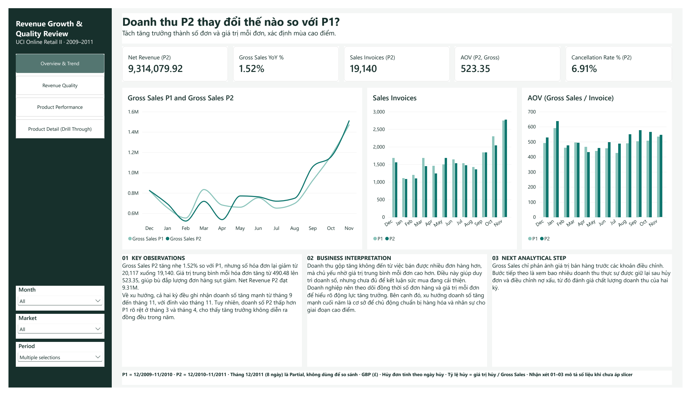
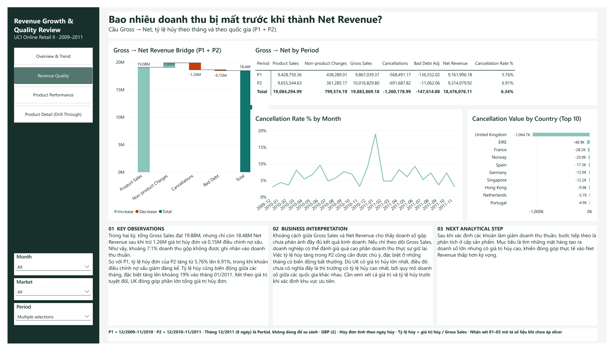
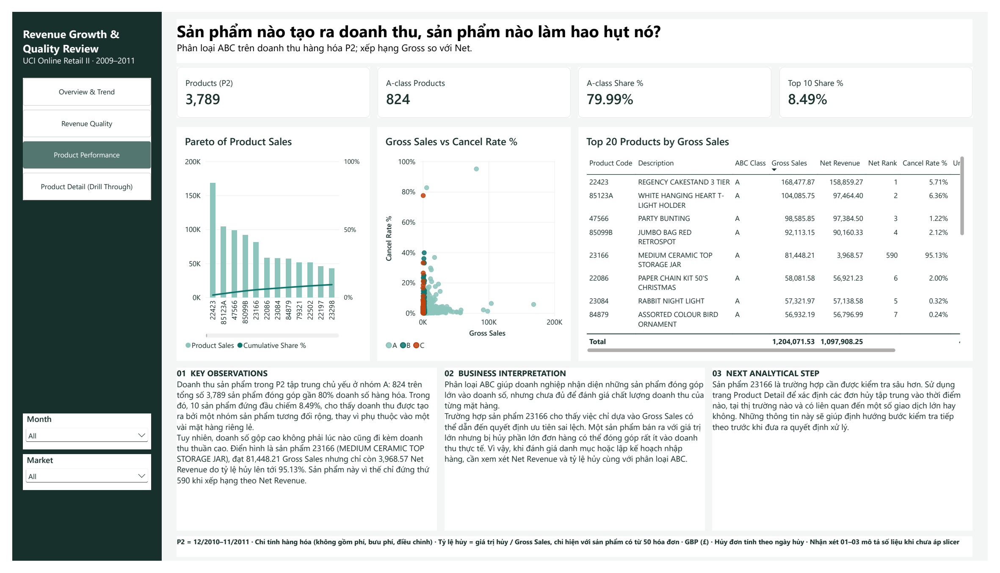
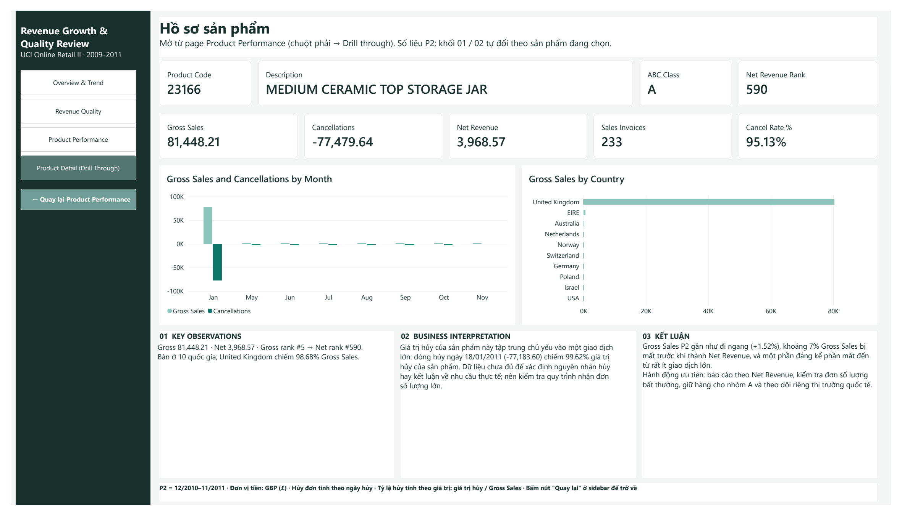

**English** | [Tiếng Việt](README.vi.md)

# Revenue Growth & Quality Review: SQL Server and Power BI

A portfolio project that uses SQL Server and Power BI to check whether an online retailer's revenue really grew, how much of it was kept after cancellations and bad debt, and which products created or eroded it.



## Contents

1. [Project Overview](#1-project-overview)
2. [Business Problem and Questions](#2-business-problem-and-questions)
3. [Dataset](#3-dataset)
4. [Analytical Workflow](#4-analytical-workflow)
5. [Data Preparation](#5-data-preparation)
6. [Dashboard Overview](#6-dashboard-overview)
7. [Key Findings](#7-key-findings)
8. [Business Recommendations](#8-business-recommendations)
9. [Technical Implementation](#9-technical-implementation)
10. [Repository Structure](#10-repository-structure)
11. [How to Use](#11-how-to-use)
12. [Assumptions and Limitations](#12-assumptions-and-limitations)
13. [References](#13-references)

## 1. Project Overview

| | |
|---|---|
| **Type** | Personal portfolio project with a constructed business scenario |
| **Data** | UCI Online Retail II: 1,067,371 invoice lines from a UK online gift retailer, Dec 2009 to Dec 2011 |
| **Purpose** | Separate real growth from order-value effects, measure revenue lost before Net Revenue, and find the products behind it |
| **Tools** | SQL Server 2022, Power BI Desktop, DAX |
| **Dashboard language** | Vietnamese. This README explains each page in English |

## 2. Business Problem and Questions

Gross Sales went up slightly from one year to the next. Before setting next year's targets, the business needs to know whether that growth is real, how much of it survives cancellations, and whether a few products distort the picture.

**Main question:**

> Is revenue really growing, and does the growth hold once cancellations and adjustments are counted?

| ID | Question | Assumed reader |
|---|---|---|
| BQ1 | How did revenue in P2 change versus P1? Was the change driven by the number of orders or by order value? Which months peak? | Commercial director |
| BQ2 | How much Gross Sales is lost to cancellations and bad debt, by month and country? | Finance manager |
| BQ3 | Which products create revenue, and which erode it? | Buying manager |

**Periods:** P1 = Dec 2009 – Nov 2010; P2 = Dec 2010 – Nov 2011. Dec 2011 has only 8 trading days and is excluded from comparisons.

## 3. Dataset

| Item | Detail |
|---|---|
| **Source** | [UCI Machine Learning Repository: Online Retail II](https://archive.ics.uci.edu/dataset/502/online+retail+ii) |
| **Grain** | One row per invoice line |
| **Sheets** | `Year 2009-2010` (525,461 rows) and `Year 2010-2011` (541,910 rows) |
| **Coverage** | 43 countries; 5,070 product codes and 61 non-product codes (postage, fees, manual lines) |
| **Currency** | Pounds sterling (£) |

The two sheets overlap in December 2010. After removing the overlap, 1,044,848 lines remain, with Net Revenue of £18,909,762.12. Totals reconcile across SQL and Power BI.

An unmodified copy of the source workbook is in [`data/raw/`](data/raw/), with attribution in [References](#13-references).

## 4. Analytical Workflow

```text
Raw workbook → SQL Server (raw → stg → core → mart) → Power BI model → DAX → 4-page dashboard → Insights
```

1. **Load:** Save each sheet as CSV and load it as text, keeping the Excel row number.
2. **Clean and classify in SQL:** Types, overlap removal, transaction types, product codes, date and product dimensions.
3. **Answer each question in SQL first:** `mart` views give the expected numbers before any visual is built.
4. **Model:** Import the `core` star schema into Power BI. No Power Query transformations.
5. **DAX:** 18 calculation measures, each checked against the matching SQL view.
6. **Dashboard:** 4 pages, each with key observations, business interpretation and next analytical step.

Full detail: [Project Methodology](docs/Project_Methodology.md).

## 5. Data Preparation

| Line type | Rule | Value (£) |
|---|---|---:|
| Sale | No `C`/`A` prefix, quantity > 0, price > 0 | 20,522,679.86 |
| Cancellation | Invoice starts with `C`, counted on the cancellation date | −1,465,303.66 |
| Bad debt adjustment | Invoice starts with `A` | −147,614.08 |
| Zero price, stock adjustment | Quantity or price is zero | 0.00 |
| **Net Revenue** | | **18,909,762.12** |

Main decisions:

- **Overlap:** sheet 2009-2010 rows from 1 Dec 2010 onward are dropped, so December 2010 is counted once.
- **Products:** codes are cleaned with `UPPER(TRIM())`. A code is a product only if it starts with five digits; postage, fees and manual lines are kept as non-product charges.
- **Duplicates:** 11,812 lines are exact copies of another line in the same sheet. They are kept and flagged. Their value is 0.29% of Net Revenue.
- **Cancellation rate:** cancelled value ÷ Gross Sales. It is a share of money, not a share of invoices.
- **ABC class:** computed on P2 Product Sales. A covers the first 80% of sales, B the next 15%, C the rest.

Full detail: [SQL Pipeline](docs/SQL_Pipeline.md) and [Decisions and QA](docs/Decisions_and_QA.md).

## 6. Dashboard Overview

| Page | Purpose | Main content |
|---|---|---|
| **1. Overview & Trend** | Answer BQ1 | KPIs; monthly Gross Sales P1 vs P2; invoices and AOV by month |
| **2. Revenue Quality** | Answer BQ2 | Gross → Net waterfall; P1 vs P2 bridge table; cancellation rate by month; cancellation value by country |
| **3. Product Performance** | Answer BQ3 | ABC KPIs; Pareto chart; Gross Sales vs cancellation rate scatter; Top 20 products with gross and net rank |
| **4. Product Detail** (drill-through) | Profile one product | Product KPIs; gross and cancellations by month and country; commentary that changes with the product |

Slicers for Month, Market (UK / International) and Period are synced across pages.

<details>
<summary>View all pages</summary>

### Revenue Quality


### Product Performance


### Product Detail (drill-through, product 23166)


</details>

Screenshots come from the [exported PDF](dashboard/Revenue_Growth_Quality_Review.pdf) of the final dashboard.

## 7. Key Findings

All figures were checked against SQL and the Power BI model.

1. **Growth came from order value, not order count.** Gross Sales rose 1.52% from P1 to P2 (Net Revenue +1.66%). Invoices fell 4.86% (20,117 → 19,140), while average order value rose 6.70% (£490.48 → £523.35).
2. **Strong year-end season, uneven year.** In both periods sales climb from September and peak in November. March and April 2011 were 13.91% and 21.09% below the same months a year earlier.
3. **About 7.1% of Gross Sales is not kept.** Across P1 and P2, £19.88M Gross Sales became £18.48M Net Revenue after £1.26M of cancellations and £0.15M of bad debt.
4. **The cancellation rate rose while bad debt fell.** Cancelled value went from 5.76% to 6.91% of Gross Sales. Bad debt fell from £136.6K to £11.1K. January 2011 had the highest monthly rate, 19.0%.
5. **The UK dominates cancellation value.** It accounts for 84% of cancelled value, in line with its share of sales. Value alone does not show which markets have the highest rate.
6. **Revenue is spread across many products.** 824 of 3,789 products with P2 sales (class A) make 79.99% of Product Sales; the top 10 make only 8.49%.
7. **A high gross rank can hide very low net revenue.** Product 23166 ranks #5 by Gross Sales (£81,448.21) but #590 by Net Revenue (£3,968.57), with a 95.13% cancellation rate. 99.62% of this product's cancelled value comes from one line on 18 Jan 2011. The data does not show why it was cancelled, so it says nothing about real demand for the product.

## 8. Business Recommendations

These are proposed actions based on the findings. They were not implemented, so no business impact was measured.

| Owner | Proposed action | Based on |
|---|---|---|
| **Commercial** | Track order count and order value separately before setting next year's target | Finding 1 |
| **Operations** | Plan stock and staffing for September to November from August | Finding 2 |
| **Finance** | Report Net Revenue alongside Gross Sales | Findings 3, 4 |
| **Finance and sales** | Investigate the January 2011 cancellation spike; compare markets by rate as well as value | Findings 4, 5 |
| **Buying** | Use Net Revenue rank and cancellation rate with ABC class when planning stock; review unusually large orders before accepting them | Findings 6, 7 |

## 9. Technical Implementation

| Tool | Actual role |
|---|---|
| **SQL Server 2022** | Load, typing, overlap removal, classification, dimensions, ABC class, `mart` views used as the answer key |
| **Power BI** | Import of the `core` tables, star schema, 4-page dashboard, drill-through, synced slicers |
| **DAX** | 18 calculation measures using `CALCULATE`, `DIVIDE`, `RANKX`, `SUMX`, `ADDCOLUMNS`, `ALL` and `HASONEVALUE`, plus 3 calculated columns |

**Model:**

```text
core dim_date ← core fact_invoice_line → core dim_product
```

Many-to-one, single direction. Measures are in a separate `_Measures` table.

Details: [DAX Measures](docs/DAX_Measures.md), [Data Dictionary](docs/Data_Dictionary.md).

## 10. Repository Structure

```text
.
├── README.md                     English README
├── README.vi.md                  Vietnamese README
├── .gitignore
├── assets/screenshots/           4 dashboard page images
├── dashboard/
│   ├── Revenue_Growth_Quality_Review.pbix
│   └── Revenue_Growth_Quality_Review.pdf
├── data/raw/
│   └── online_retail_II.xlsx
├── sql/                          01_setup.sql … 09_abc_product.sql
└── docs/
    ├── Project_Methodology.md
    ├── SQL_Pipeline.md
    ├── Data_Dictionary.md
    ├── DAX_Measures.md
    └── Decisions_and_QA.md
```

## 11. How to Use

**To review the results:** Open the [PDF](dashboard/Revenue_Growth_Quality_Review.pdf) or the screenshots above. No software is needed.

**To explore the dashboard:** Install Power BI Desktop for Windows and open [`dashboard/Revenue_Growth_Quality_Review.pbix`](dashboard/Revenue_Growth_Quality_Review.pbix). The file was checked on version 2.159. The data is stored in the file, so no SQL Server or refresh is needed. To open Product Detail, right-click a product on the Product Performance page and choose **Drill through → Product Detail**.

**To rebuild the data:**

1. Install SQL Server 2022 or later (Express is enough).
2. Open `data/raw/online_retail_II.xlsx` and save each sheet as **CSV UTF-8**: `sheet_2009_2010.csv` and `sheet_2010_2011.csv` in `data/raw/`. Check that `InvoiceDate` in the CSV is written as day first, `d/mm/yyyy h:mm` (for example `1/12/2009 7:45`). Excel uses the Windows regional format when it saves CSV, and `sql/03_stg.sql` reads dates with style 103 (`dd/mm/yyyy`). If your CSV shows `mm/dd/yyyy`, change `103` to `101` in that script.
3. In `sql/02_load_raw.sql`, replace `<REPO_PATH>` with the folder of your copy of this repository.
4. Run the scripts in `sql/` in number order (`01` to `09`).
5. Compare the results with the expected values in [Decisions and QA](docs/Decisions_and_QA.md#key-figures-sql-vs-power-bi). The `stg.invoice_line` table should have 1,044,848 rows.
6. In Power BI Desktop, go to **Home → Transform data → Data source settings**, change the server to your SQL Server instance, then select **Refresh**.

## 12. Assumptions and Limitations

- **The scenario is constructed.** The readers are assumed roles; there was no real client.
- **Cancellations are not linked to their original sale.** A cancellation is counted in the month it happened, so a P2 cancellation can relate to a P1 sale.
- **No cost, margin, return-reason or stock data.** Causes of cancellations and profitability cannot be determined.
- **A cancellation share does not explain the cause.** Product Detail shows where cancelled value is concentrated, not why orders were cancelled.
- **Duplicates are kept.** 11,812 identical lines (0.29% of Net Revenue) may be data-entry repeats.
- **ABC uses one year.** Classes are based on P2 and can change in another period.
- **Product cancellation rate needs at least 50 invoices.** Products below that show no rate.
- **Commentary on pages 1 to 3 is static.** It describes the unfiltered view and does not change with slicers. Page 4 commentary changes with the selected product.

## 13. References

- Chen, D. (2012). *Online Retail II* [Dataset]. UCI Machine Learning Repository. https://doi.org/10.24432/C5CG6D. Licensed under [CC BY 4.0](https://creativecommons.org/licenses/by/4.0/). The workbook is included unmodified.
- [Microsoft Power BI documentation](https://learn.microsoft.com/power-bi/)
- [SQL Server documentation](https://learn.microsoft.com/sql/sql-server/)
