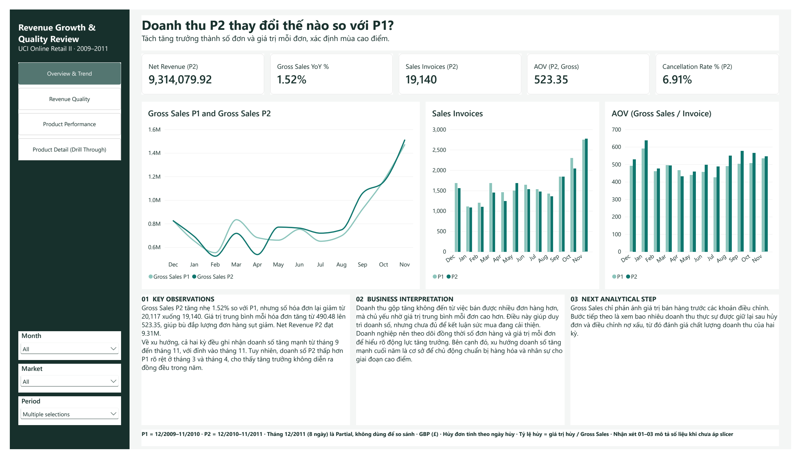
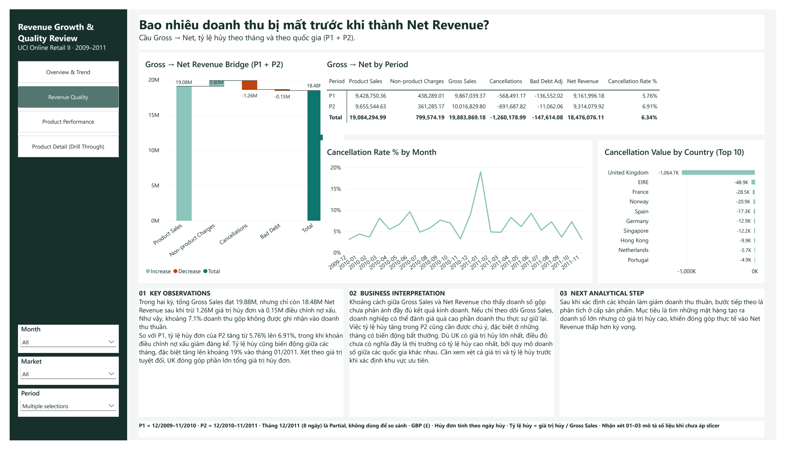
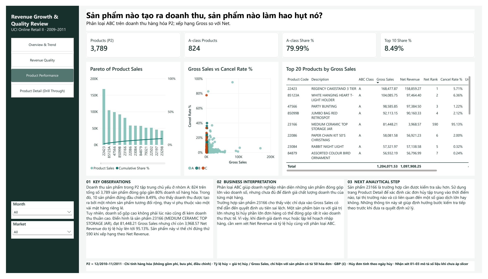
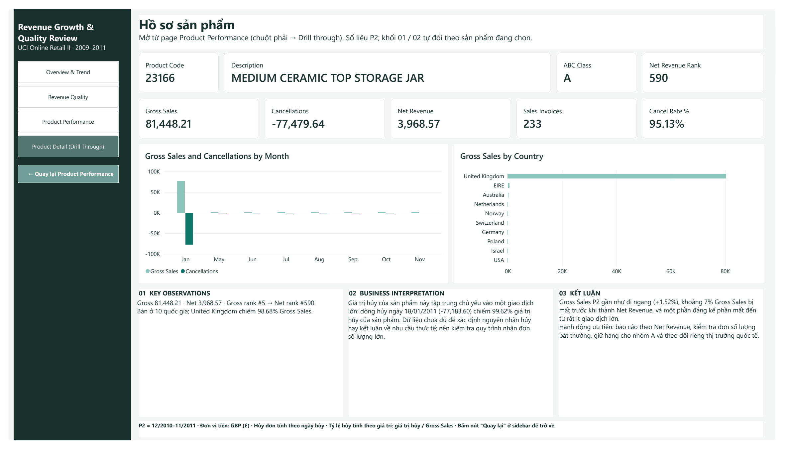

[English](README.md) | **Tiếng Việt**

# Revenue Growth & Quality Review: SQL Server và Power BI

Dự án portfolio dùng SQL Server và Power BI để kiểm tra doanh thu của một nhà bán lẻ trực tuyến có thực sự tăng hay không, bao nhiêu doanh thu còn lại sau hủy đơn và nợ xấu, và sản phẩm nào tạo ra hoặc làm hao hụt doanh thu.



## Mục lục

1. [Tổng quan dự án](#1-tổng-quan-dự-án)
2. [Vấn đề kinh doanh và câu hỏi](#2-vấn-đề-kinh-doanh-và-câu-hỏi)
3. [Bộ dữ liệu](#3-bộ-dữ-liệu)
4. [Quy trình phân tích](#4-quy-trình-phân-tích)
5. [Chuẩn bị dữ liệu](#5-chuẩn-bị-dữ-liệu)
6. [Tổng quan dashboard](#6-tổng-quan-dashboard)
7. [Phát hiện chính](#7-phát-hiện-chính)
8. [Đề xuất kinh doanh](#8-đề-xuất-kinh-doanh)
9. [Triển khai kỹ thuật](#9-triển-khai-kỹ-thuật)
10. [Cấu trúc repository](#10-cấu-trúc-repository)
11. [Cách sử dụng](#11-cách-sử-dụng)
12. [Giả định và giới hạn](#12-giả-định-và-giới-hạn)
13. [Tài liệu tham khảo](#13-tài-liệu-tham-khảo)

## 1. Tổng quan dự án

| | |
|---|---|
| **Loại dự án** | Dự án portfolio cá nhân với tình huống kinh doanh giả lập |
| **Dữ liệu** | UCI Online Retail II: 1,067,371 dòng hóa đơn của một nhà bán quà tặng trực tuyến tại Anh, từ 12/2009 đến 12/2011 |
| **Mục đích** | Tách tăng trưởng thật khỏi tác động của giá trị đơn hàng, đo phần doanh thu bị mất trước khi thành Net Revenue, và tìm sản phẩm gây ra phần mất đó |
| **Công cụ** | SQL Server 2022, Power BI Desktop, DAX |
| **Ngôn ngữ dashboard** | Tiếng Việt |

## 2. Vấn đề kinh doanh và câu hỏi

Gross Sales tăng nhẹ so với năm trước. Trước khi đặt mục tiêu cho năm sau, doanh nghiệp cần biết tăng trưởng đó có thật không, bao nhiêu còn lại sau hủy đơn, và có vài sản phẩm nào làm sai lệch bức tranh hay không.

**Câu hỏi chính:**

> Doanh thu có thực sự tăng, và mức tăng đó có còn giữ được khi tính đúng hủy đơn và các khoản điều chỉnh?

| ID | Câu hỏi | Người đọc giả định |
|---|---|---|
| BQ1 | Doanh thu P2 thay đổi thế nào so với P1? Thay đổi đến từ số đơn hay giá trị mỗi đơn? Tháng nào là cao điểm? | Giám đốc kinh doanh |
| BQ2 | Bao nhiêu Gross Sales bị mất do hủy đơn và nợ xấu, theo tháng và theo quốc gia? | Trưởng phòng tài chính |
| BQ3 | Sản phẩm nào tạo ra doanh thu, sản phẩm nào làm hao hụt nó? | Trưởng phòng mua hàng |

**Kỳ so sánh:** P1 = 12/2009 – 11/2010; P2 = 12/2010 – 11/2011. Tháng 12/2011 chỉ có 8 ngày giao dịch nên không dùng để so sánh.

## 3. Bộ dữ liệu

| Mục | Chi tiết |
|---|---|
| **Nguồn** | [UCI Machine Learning Repository: Online Retail II](https://archive.ics.uci.edu/dataset/502/online+retail+ii) |
| **Mức chi tiết** | Mỗi dòng là một dòng hóa đơn |
| **Sheet** | `Year 2009-2010` (525,461 dòng) và `Year 2010-2011` (541,910 dòng) |
| **Phạm vi** | 43 quốc gia; 5,070 mã sản phẩm và 61 mã không phải sản phẩm (phí vận chuyển, phí, dòng nhập tay) |
| **Đơn vị tiền** | Bảng Anh (£) |

Hai sheet trùng nhau ở tháng 12/2010. Sau khi bỏ phần trùng còn 1,044,848 dòng, Net Revenue là £18,909,762.12. Tổng số khớp giữa SQL và Power BI.

Bản gốc của workbook, không chỉnh sửa, nằm trong [`data/raw/`](data/raw/). Nguồn trích dẫn ở mục [Tài liệu tham khảo](#13-tài-liệu-tham-khảo).

## 4. Quy trình phân tích

```text
Workbook gốc → SQL Server (raw → stg → core → mart) → Model Power BI → DAX → Dashboard 4 trang → Nhận xét
```

1. **Nạp dữ liệu:** Lưu từng sheet thành CSV và nạp dạng text, giữ số dòng trong Excel để truy ngược.
2. **Làm sạch và phân loại bằng SQL:** Ép kiểu, bỏ phần trùng, phân loại giao dịch, chuẩn hóa mã sản phẩm, tạo dimension ngày và sản phẩm.
3. **Trả lời từng câu hỏi bằng SQL trước:** Các view `mart` cho ra con số chuẩn trước khi dựng biểu đồ.
4. **Model:** Import star schema `core` vào Power BI. Không biến đổi dữ liệu trong Power Query.
5. **DAX:** 18 measure tính toán, mỗi measure được đối chiếu với view SQL tương ứng.
6. **Dashboard:** 4 trang, mỗi trang có 3 khối Key Observations, Business Interpretation và Next Analytical Step.

Chi tiết: [Project Methodology](docs/Project_Methodology.md) (tiếng Anh).

## 5. Chuẩn bị dữ liệu

| Loại dòng | Quy tắc | Giá trị (£) |
|---|---|---:|
| Sale | Không có tiền tố `C`/`A`, số lượng > 0, giá > 0 | 20,522,679.86 |
| Cancellation | Số hóa đơn bắt đầu bằng `C`, tính theo ngày hủy | −1,465,303.66 |
| Bad debt adjustment | Số hóa đơn bắt đầu bằng `A` | −147,614.08 |
| Zero price, stock adjustment | Số lượng hoặc giá bằng 0 | 0.00 |
| **Net Revenue** | | **18,909,762.12** |

Các quyết định chính:

- **Phần trùng:** bỏ các dòng của sheet 2009-2010 từ ngày 01/12/2010, để tháng 12/2010 chỉ được tính một lần.
- **Sản phẩm:** mã được chuẩn hóa bằng `UPPER(TRIM())`. Chỉ mã bắt đầu bằng 5 chữ số mới là sản phẩm; phí vận chuyển, phí và dòng nhập tay được giữ là non-product charges.
- **Dòng trùng:** 11,812 dòng giống hệt một dòng khác trong cùng sheet. Các dòng này được giữ lại và gắn cờ. Giá trị của chúng là 0.29% Net Revenue.
- **Tỷ lệ hủy:** giá trị hủy ÷ Gross Sales. Đây là tỷ lệ theo giá trị tiền, không phải tỷ lệ số hóa đơn bị hủy.
- **Phân loại ABC:** tính trên Product Sales của P2. Nhóm A chiếm 80% doanh số đầu tiên, B 15% tiếp theo, C phần còn lại.

Chi tiết: [SQL Pipeline](docs/SQL_Pipeline.md) và [Decisions and QA](docs/Decisions_and_QA.md) (tiếng Anh).

## 6. Tổng quan dashboard

| Trang | Mục đích | Nội dung chính |
|---|---|---|
| **1. Overview & Trend** | Trả lời BQ1 | KPI; Gross Sales theo tháng P1 so với P2; số hóa đơn và AOV theo tháng |
| **2. Revenue Quality** | Trả lời BQ2 | Waterfall Gross → Net; bảng đối chiếu P1 và P2; tỷ lệ hủy theo tháng; giá trị hủy theo quốc gia |
| **3. Product Performance** | Trả lời BQ3 | KPI ABC; biểu đồ Pareto; scatter Gross Sales và tỷ lệ hủy; Top 20 sản phẩm với xếp hạng Gross và Net |
| **4. Product Detail** (drill-through) | Hồ sơ một sản phẩm | KPI sản phẩm; doanh số và hủy theo tháng, theo quốc gia; nhận xét tự đổi theo sản phẩm |

Slicer Month, Market (UK / International) và Period được đồng bộ giữa các trang.

<details>
<summary>Xem tất cả các trang</summary>

### Revenue Quality


### Product Performance


### Product Detail (drill-through, sản phẩm 23166)


</details>

Ảnh chụp lấy từ [bản PDF](dashboard/Revenue_Growth_Quality_Review.pdf) của dashboard cuối cùng.

## 7. Phát hiện chính

Mọi con số đã được đối chiếu với SQL và model Power BI.

1. **Tăng trưởng đến từ giá trị đơn hàng, không phải số đơn.** Gross Sales P2 tăng 1.52% so với P1 (Net Revenue tăng 1.66%). Số hóa đơn giảm 4.86% (20,117 → 19,140), trong khi giá trị trung bình mỗi đơn tăng 6.70% (£490.48 → £523.35).
2. **Cao điểm cuối năm rõ, nhưng cả năm không đều.** Ở cả hai kỳ, doanh số tăng từ tháng 9 và đạt đỉnh tháng 11. Tháng 3 và 4/2011 thấp hơn cùng kỳ năm trước lần lượt 13.91% và 21.09%.
3. **Khoảng 7.1% Gross Sales không được giữ lại.** Qua P1 và P2, £19.88M Gross Sales còn £18.48M Net Revenue sau £1.26M hủy đơn và £0.15M nợ xấu.
4. **Tỷ lệ hủy tăng trong khi nợ xấu giảm.** Tỷ lệ hủy theo giá trị tăng từ 5.76% lên 6.91% Gross Sales. Nợ xấu giảm từ £136.6K xuống £11.1K. Tháng 01/2011 có tỷ lệ hủy cao nhất, 19.0%.
5. **UK chiếm phần lớn giá trị hủy.** UK chiếm 84% giá trị hủy, tương ứng tỷ trọng doanh số. Chỉ nhìn giá trị thì chưa biết thị trường nào có tỷ lệ hủy cao nhất.
6. **Doanh thu phân bổ trên nhiều sản phẩm.** 824 trên 3,789 sản phẩm có doanh số P2 (nhóm A) tạo ra 79.99% Product Sales; 10 sản phẩm đầu chỉ chiếm 8.49%.
7. **Xếp hạng Gross cao có thể che giấu Net Revenue rất thấp.** Sản phẩm 23166 đứng #5 theo Gross Sales (£81,448.21) nhưng #590 theo Net Revenue (£3,968.57), tỷ lệ hủy 95.13%. 99.62% giá trị hủy của riêng sản phẩm này đến từ một dòng ngày 18/01/2011. Dữ liệu không cho biết lý do hủy, nên chưa thể kết luận về nhu cầu thực tế của sản phẩm.

## 8. Đề xuất kinh doanh

Đây là các hành động đề xuất dựa trên phát hiện. Chưa được triển khai nên chưa đo được tác động.

| Bộ phận | Hành động đề xuất | Dựa trên |
|---|---|---|
| **Kinh doanh** | Theo dõi riêng số đơn và giá trị mỗi đơn trước khi đặt mục tiêu năm sau | Phát hiện 1 |
| **Vận hành** | Lên kế hoạch hàng hóa và nhân sự cho tháng 9 đến 11 từ tháng 8 | Phát hiện 2 |
| **Tài chính** | Báo cáo Net Revenue song song với Gross Sales | Phát hiện 3, 4 |
| **Tài chính và kinh doanh** | Tìm nguyên nhân đỉnh hủy tháng 01/2011; so sánh thị trường theo cả tỷ lệ lẫn giá trị hủy | Phát hiện 4, 5 |
| **Mua hàng** | Dùng xếp hạng Net Revenue và tỷ lệ hủy cùng phân loại ABC khi lập kế hoạch nhập hàng; kiểm tra đơn số lượng bất thường trước khi nhận | Phát hiện 6, 7 |

## 9. Triển khai kỹ thuật

| Công cụ | Vai trò thực tế |
|---|---|
| **SQL Server 2022** | Nạp dữ liệu, ép kiểu, bỏ phần trùng, phân loại, dimension, phân loại ABC, các view `mart` dùng làm đáp án chuẩn |
| **Power BI** | Import bảng `core`, star schema, dashboard 4 trang, drill-through, slicer đồng bộ |
| **DAX** | 18 measure tính toán dùng `CALCULATE`, `DIVIDE`, `RANKX`, `SUMX`, `ADDCOLUMNS`, `ALL`, `HASONEVALUE`, cùng 3 cột tính toán |

**Model:**

```text
core dim_date ← core fact_invoice_line → core dim_product
```

Quan hệ many-to-one, một chiều. Measure nằm trong bảng `_Measures` riêng.

Chi tiết: [DAX Measures](docs/DAX_Measures.md), [Data Dictionary](docs/Data_Dictionary.md) (tiếng Anh).

## 10. Cấu trúc repository

```text
.
├── README.md                     README tiếng Anh
├── README.vi.md                  README tiếng Việt
├── .gitignore
├── assets/screenshots/           Ảnh 4 trang dashboard
├── dashboard/
│   ├── Revenue_Growth_Quality_Review.pbix
│   └── Revenue_Growth_Quality_Review.pdf
├── data/raw/
│   └── online_retail_II.xlsx
├── sql/                          01_setup.sql … 09_abc_product.sql
└── docs/
    ├── Project_Methodology.md
    ├── SQL_Pipeline.md
    ├── Data_Dictionary.md
    ├── DAX_Measures.md
    └── Decisions_and_QA.md
```

## 11. Cách sử dụng

**Xem kết quả:** Mở [PDF](dashboard/Revenue_Growth_Quality_Review.pdf) hoặc các ảnh ở trên, không cần cài phần mềm.

**Khám phá dashboard:** Cài Power BI Desktop cho Windows và mở [`dashboard/Revenue_Growth_Quality_Review.pbix`](dashboard/Revenue_Growth_Quality_Review.pbix). File đã được kiểm tra trên phiên bản 2.159. Dữ liệu đã lưu sẵn trong file nên không cần SQL Server hay refresh. Để mở Product Detail, chuột phải vào một sản phẩm ở trang Product Performance và chọn **Drill through → Product Detail**.

**Dựng lại dữ liệu:**

1. Cài SQL Server 2022 trở lên (bản Express là đủ).
2. Mở `data/raw/online_retail_II.xlsx`, lưu từng sheet thành **CSV UTF-8**: `sheet_2009_2010.csv` và `sheet_2010_2011.csv` trong `data/raw/`. Kiểm tra cột `InvoiceDate` trong CSV có dạng ngày đứng trước, dạng `d/mm/yyyy h:mm` (ví dụ `1/12/2009 7:45`). Excel lưu CSV theo định dạng vùng của Windows, còn `sql/03_stg.sql` đọc ngày theo style 103 (`dd/mm/yyyy`). Nếu CSV của bạn là `mm/dd/yyyy`, đổi `103` thành `101` trong script đó.
3. Trong `sql/02_load_raw.sql`, thay `<REPO_PATH>` bằng thư mục chứa bản sao repository trên máy bạn.
4. Chạy các script trong `sql/` theo thứ tự số (`01` đến `09`).
5. Đối chiếu kết quả với giá trị kỳ vọng trong [Decisions and QA](docs/Decisions_and_QA.md#key-figures-sql-vs-power-bi). Bảng `stg.invoice_line` phải có 1,044,848 dòng.
6. Trong Power BI Desktop, vào **Home → Transform data → Data source settings**, đổi server sang instance SQL Server của bạn, rồi chọn **Refresh**.

## 12. Giả định và giới hạn

- **Tình huống là giả lập.** Người đọc là các vai trò giả định; không có khách hàng thật.
- **Hủy đơn không được nối với đơn bán gốc.** Hủy được tính vào tháng phát sinh, nên một dòng hủy ở P2 có thể thuộc về đơn bán ở P1.
- **Không có dữ liệu chi phí, biên lợi nhuận, lý do trả hàng hay tồn kho.** Không xác định được nguyên nhân hủy đơn hay lợi nhuận.
- **Tỷ trọng hủy không giải thích nguyên nhân.** Trang Product Detail cho thấy giá trị hủy tập trung ở đâu, không cho biết vì sao đơn bị hủy.
- **Dòng trùng được giữ lại.** 11,812 dòng giống hệt nhau (0.29% Net Revenue) có thể là lỗi nhập liệu.
- **ABC chỉ dùng một năm.** Phân loại dựa trên P2 và có thể khác ở kỳ khác.
- **Tỷ lệ hủy theo sản phẩm cần ít nhất 50 hóa đơn.** Sản phẩm dưới ngưỡng này không hiển thị tỷ lệ.
- **Nhận xét ở trang 1 đến 3 là cố định.** Nhận xét mô tả góc nhìn chưa lọc và không đổi theo slicer. Nhận xét ở trang 4 tự đổi theo sản phẩm được chọn.

## 13. Tài liệu tham khảo

- Chen, D. (2012). *Online Retail II* [Dataset]. UCI Machine Learning Repository. https://doi.org/10.24432/C5CG6D. Giấy phép [CC BY 4.0](https://creativecommons.org/licenses/by/4.0/). Workbook được đưa vào nguyên bản, không chỉnh sửa.
- [Tài liệu Microsoft Power BI](https://learn.microsoft.com/power-bi/)
- [Tài liệu SQL Server](https://learn.microsoft.com/sql/sql-server/)
